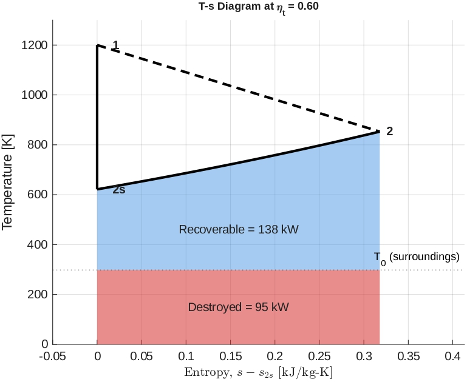

# Turbine second law

A Matlab model of an adiabatic turbine, built to help me understand why the thermodynamics 2nd law still matters when the 1st law balances

## Why?

In Thermo I, I could never build a solid physical intuition for the 2nd law beyond just plugging nums into formulas. I knew energy in and out was conserved like a strict scalar ledger, but I couldn't visualize why a process was forbidden from just running in reverse. When I modeled this turbine, the 1st law residual was zero at every efficiency, so we can infer all the energy was accounted for. But entropy generation says something was still "lost." If the energy is all still in the system( hot exhaust), what exactly does "lost" mean?

## The Model

Air enters at 926.8 C and 1000 kPa and expands to 100 kPa at 1 kg/s mass flow rate. 
Ideal gas, constant specific heats, surroundings is at 25 C

I changed the isentropic efficiency and compute, for each value:

- exit temperature and shaft power from the 1st law
- entropy generation from the ideal gas entropy change
- the work potential lost, given by surr temp. times entropy gen

## Results

### T-s diagram at 60%

Vertical line is the ideal turbine (no entropy change). The dashed line
is my real turbine, which ends at 853 K instead of 621 K. The 232 kW of
missing shaft work is still in the air, and it splits into two parts: the red
area (T0 * sgen, about 95 kW) can't be recovered or turned into work, and the blue area
(about 138 kW) could still be recovered and used in principle.

### Moving Past 100% efficiency

Above 100% the 1st law residual is still zero, so the energy balance still accepts
it. But entropy gen goes negative (abt -0.21 kJ/kg-K at 120%), so the
2nd law rejects it. 

### Missing work vs efficiency

The lower the efficiency, the further from the wall (ideal), and the more lost work.

